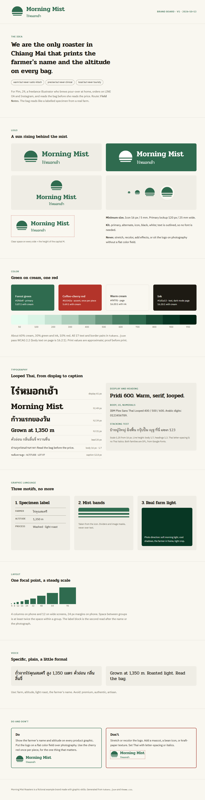

# Graphic Skills

Design skills for **Codex** and **Claude Code** that work the way a studio does: learn the brand first, interview you until it is clear, show real options, build a system, then make and critique every graphic against it. Thai-ready. [อ่านภาษาไทย](README.th.md)

On Codex, the skills also drive the built-in image generator (`$imagegen`): they write the prompt from your brand memory, so generated pictures carry your palette, light, and guardrails.

The shape follows [mattpocock/skills](https://github.com/mattpocock/skills): commands you type (`/grill-brand`), plus a few reference skills the agent loads by itself.

## Install

Pick **one** method per agent. Installing two ways gives you every skill twice.

**Codex or any agent, with the `skills` installer** (needs Node):

```bash
npx skills@latest add whanoftheworld/graphic-skills -g -a codex
# Claude Code instead: -a claude-code
```

**Claude Code plugin:**

```bash
claude plugin marketplace add whanoftheworld/graphic-skills
claude plugin install graphic-skills@whanoftheworld
```

**Codex plugin** (written from the Codex docs; I could not run Codex while building this, so treat it as untested):

```bash
codex plugin marketplace add whanoftheworld/graphic-skills
```

**By hand:** copy the folders in [`skills/`](skills) into `~/.agents/skills` (Codex, user scope) or `~/.claude/skills` (Claude Code). Codex also reads `.agents/skills` inside a repo.

Restart the agent if the skills do not appear.

## Use

Type a command. In Claude Code it is `/grill-brand`; in Codex it is `$grill-brand` or pick it from `/skills` (per the [Codex skills docs](https://learn.chatgpt.com/docs/build-skills.md); the Codex app may also list it as a slash command).

- **I have a logo, fonts, or past work** → `/brand-intake`
- **I only have a business and a feeling** → `/grill-brand`
- **Not sure** → `/ask-designer`

Everything the commands learn goes into one file, `brand/BRAND.md` (the **brand memory**), plus `tokens.json` and `theme.css` once the system is built. Every later graphic reads them, so the agent never starts from zero, and you can `/clear` between commands.

## The flow

```
 you have a brand ──► /brand-intake ─┐
                                     ├─► /design-routes ─► /type-system ─► /logo-lab ─► /color-system ─► /brand-system
 you have an idea ──► /grill-brand ──┘     (3 routes,        (fonts,         (logo kit)   (palette,        (tokens, theme,
                                            pick one)         Thai too)                    contrast proof)   brand board, rules)

 every graphic after that:   /design-brief ─► /brand-image ─► /make-graphic ─► /design-critique ─┐
                                   ▲        (Codex image gen)                                │ system-level findings
                                   └─────────────────────────────────────────────────────────┘ go back to the owning command
```

The order follows what the best studios converge on: listen, define, explore a few real routes, build the system, apply, critique, loop. The sources, and what could not be verified, are in [docs/research.md](docs/research.md).

## Why these skills exist

**#1: The agent doesn't know my brand, so every graphic is generic.**
`/brand-intake` memorizes your logo, fonts, and colors and audits them. The model-invoked `brand-context` skill then loads the brand memory before any graphic work, on its own.

**#2: The agent decides for me, or asks questions I can't answer.**
`/grill-brand` interviews in rounds of at most five questions, each with a recommended answer. When you can't put taste into words it shows you A/B options instead, and when you name a font or logo you like it asks what exactly you like about it, because "I like Nike" is trivia and "one bold shape carries the whole brand" is a requirement. `/design-routes` shows three genuinely different directions rendered side by side.

**#3: It looks fine, but it's unreadable, off-brand, or the Thai tone marks collide.**
Numbers come from scripts, not from the model's eye: `contrast.mjs` proves every text pair against WCAG 2.2 and exits non-zero on failure, and `palette.mjs` builds tonal scales in OKLCH. Logos run a seven-test gauntlet (16 px favicon, one color, reversed, squint, small print, in place, name-swap). Thai has its own stacking test and a verified list of Thai fonts. `/design-critique` returns ranked findings with a location, evidence, and a fix.

**#4: AI-generated images look generic or off-brand.**
`/brand-image` writes the image prompt from your brand memory (palette hex values, light, the guardrails, the category clichés to avoid), calls Codex's built-in image generator, checks the result for garbled text, hands, palette drift, and honesty, and saves it into your project. `/make-graphic` then puts the exact logo and type on top, because generators cannot render Thai text or logos reliably.

**#5: Every session starts from zero.**
State lives in files: `BRAND.md`, `tokens.json`, `theme.css`, and a decision log that records what was rejected and why.

## Reference

**User-invoked** (reachable only when you type them)

| Command | What it does |
| --- | --- |
| [`/ask-designer`](skills/ask-designer/SKILL.md) | Routes you to the right command for your situation. |
| [`/brand-intake`](skills/brand-intake/SKILL.md) | Takes your existing logo, fonts, colors, and past work; memorizes and audits them. |
| [`/grill-brand`](skills/grill-brand/SKILL.md) | Interviews you into a brand: purpose, audience, onlyness, personality, taste evidence. |
| [`/design-routes`](skills/design-routes/SKILL.md) | Builds three different visual directions on one page; you pick or mix. |
| [`/type-system`](skills/type-system/SKILL.md) | Reads the fonts you like, shortlists pairings, shows a specimen, defines the full type system (Thai and Latin). |
| [`/logo-lab`](skills/logo-lab/SKILL.md) | Reason for a mark, concepts, thumbnails, the test gauntlet, then the logo kit as SVG. |
| [`/color-system`](skills/color-system/SKILL.md) | Chooses the palette with reasons, builds scales, proves every contrast pair. |
| [`/brand-system`](skills/brand-system/SKILL.md) | Compiles tokens, a CSS theme, a brand board, and written guidelines. |
| [`/design-brief`](skills/design-brief/SKILL.md) | Turns a request into a one-page brief: message, viewer, format, copy, success test. |
| [`/brand-image`](skills/brand-image/SKILL.md) | Prompts the image generator (Codex `imagegen`) from your brand memory, checks the result, saves it into the project. |
| [`/make-graphic`](skills/make-graphic/SKILL.md) | Builds the graphic from tokens, places images, renders it, gates it, exports it. |
| [`/design-critique`](skills/design-critique/SKILL.md) | Reviews a design against brand, craft, accessibility, and brief, with evidence. |

**Model-invoked** (the agent loads them on its own; you can also type them)

| Skill | What it holds |
| --- | --- |
| [`brand-context`](skills/brand-context/SKILL.md) | Loads the brand memory before any graphic work, and defines its format. |
| [`design-craft`](skills/design-craft/SKILL.md) | Hierarchy, layout, typography, Thai typography, color, logo craft, graphic language, image prompting, plus the contrast and palette scripts. |
| [`design-grilling`](skills/design-grilling/SKILL.md) | The interview method: rounds, recommended answers, show-don't-tell, evidence over adjectives. |

## What you get

A worked example, [Morning Mist Roasters](examples/morning-mist) (a fictional Thai coffee roaster), shows what the commands leave behind: [`BRAND.md`](examples/morning-mist/brand/BRAND.md), [`tokens.json`](examples/morning-mist/brand/tokens.json), a generated [`theme.css`](examples/morning-mist/brand/theme.css), a logo kit with Thai outlined correctly, a [brand board](examples/morning-mist/brand/brand-board.html), and one finished Instagram graphic built from the tokens.

<p>
  
</p>

The brand board it produces (full size: [brand-board.png](examples/morning-mist/brand-board.png)):

<p>
  
</p>

## Requirements

- **Node 18+** for the scripts (`contrast.mjs`, `palette.mjs`, `build-theme.mjs`). No packages to install.
- **Optional:** Python with `pip install fonttools uharfbuzz`, only for `logo-lab/scripts/text-to-svg.py`, which turns logo text into outlines with correct Thai shaping.
- **An image generator** for `/brand-image`: on Codex, the built-in `image_gen` tool (the `imagegen` system skill, no API key needed). Without one, the skill hands you a paste-ready prompt instead.
- **A browser tool** (Playwright, Chrome DevTools, or `npx playwright screenshot`) so the agent can look at what it renders. Without one, it asks you to open the file.
- Network access for Google Fonts when previewing.

## Honest limits

- Agent-drawn logos are a sound concept with clean first-pass vectors. For a brand that will carry heavy spend, have a professional designer finish the master.
- The Thai rules are practice, not a standard: the W3C Thai layout note still lists line height and letter-spacing as open questions. The looped and loopless label for each Google Font was measured by rendering glyphs on 2026-10-13, not taken from a foundry.
- The Codex plugin route is untested here. The `skills` installer route and the manual copy follow the Codex docs.
- Platform sizes and specs change; the skills tell the agent to confirm them before fixing a canvas.

## Contributing

Conventions are in [AGENTS.md](AGENTS.md). Run `node scripts/check.mjs` before a pull request.

## License

[MIT](LICENSE)
