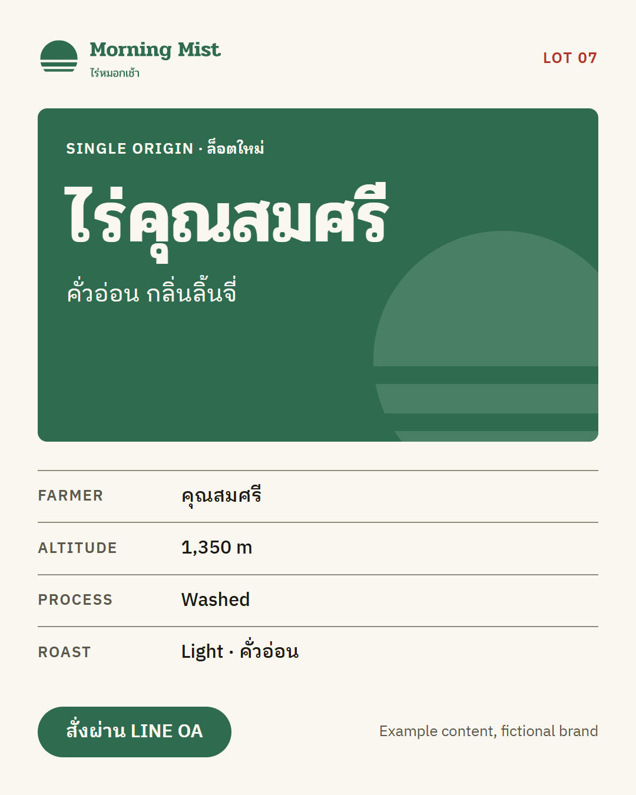

# Graphic Skills

ชุดสกิลงานออกแบบสำหรับ **Codex** และ **Claude Code** ที่ทำงานแบบสตูดิโอจริง ๆ: ทำความรู้จักแบรนด์ก่อน สัมภาษณ์จนความคิดชัด โชว์ทางเลือกที่ต่างกันจริง สร้างเป็นระบบ แล้วจึงทำกราฟิกและตรวจงานทุกชิ้นเทียบกับระบบนั้น รองรับภาษาไทย [English](README.md)

โครงสร้างตามแนวของ [mattpocock/skills](https://github.com/mattpocock/skills): มีคำสั่งที่พิมพ์เรียกเอง (`/grill-brand`) และสกิลอ้างอิงอีกไม่กี่ตัวที่เอเจนต์โหลดเอง

## ติดตั้ง

เลือก **วิธีเดียว** ต่อหนึ่งเอเจนต์ ถ้าติดตั้งซ้ำสองทางจะได้สกิลซ้ำสองชุด

**Codex หรือเอเจนต์อื่น ผ่านตัวติดตั้ง `skills`** (ต้องมี Node):

```bash
npx skills@latest add whanoftheworld/graphic-skills -g -a codex
# ถ้าใช้ Claude Code ให้เปลี่ยนเป็น -a claude-code
```

**ปลั๊กอิน Claude Code:**

```bash
claude plugin marketplace add whanoftheworld/graphic-skills
claude plugin install graphic-skills@whanoftheworld
```

**ปลั๊กอิน Codex** (เขียนตามเอกสาร Codex แต่ตอนสร้างผมรัน Codex ไม่ได้ จึงยังไม่ได้ทดสอบ):

```bash
codex plugin marketplace add whanoftheworld/graphic-skills
```

**ทำเอง:** คัดลอกโฟลเดอร์ใน [`skills/`](skills) ไปไว้ที่ `~/.agents/skills` (Codex ระดับผู้ใช้) หรือ `~/.claude/skills` (Claude Code) ส่วน Codex ยังอ่าน `.agents/skills` ในโปรเจกต์ได้ด้วย

ถ้าสกิลไม่ขึ้น ให้รีสตาร์ทเอเจนต์

## วิธีใช้

พิมพ์คำสั่ง ใน Claude Code พิมพ์ `/grill-brand` ส่วนใน Codex พิมพ์ `$grill-brand` หรือเลือกจาก `/skills` (ตามเอกสาร Codex แอป Codex อาจแสดงเป็นสแลชคอมมานด์ได้ด้วย)

- **มีโลโก้ ฟอนต์ หรืองานเก่าอยู่แล้ว** → `/brand-intake`
- **มีแค่ธุรกิจกับความรู้สึก** → `/grill-brand`
- **ไม่แน่ใจ** → `/ask-designer`

ทุกอย่างที่คำสั่งเรียนรู้จะถูกเก็บไว้ในไฟล์เดียวคือ `brand/BRAND.md` (**ความจำของแบรนด์**) และเมื่อสร้างระบบเสร็จจะมี `tokens.json` กับ `theme.css` เพิ่มมา กราฟิกทุกชิ้นหลังจากนั้นจะอ่านไฟล์เหล่านี้ เอเจนต์จึงไม่ต้องเริ่มจากศูนย์ และคุณ `/clear` ระหว่างคำสั่งได้เลย

## ลำดับการทำงาน

```
 มีแบรนด์อยู่แล้ว ──► /brand-intake ─┐
                                    ├─► /design-routes ─► /type-system ─► /logo-lab ─► /color-system ─► /brand-system
 มีแค่ไอเดีย ─────► /grill-brand ───┘    (3 ทิศทาง        (ฟอนต์          (ชุดโลโก้)    (พาเลตต์        (tokens, theme,
                                          เลือก 1)          รวมภาษาไทย)                  พิสูจน์ contrast)  brand board, กฎ)

 กราฟิกทุกชิ้นหลังจากนั้น:   /design-brief ─► /make-graphic ─► /design-critique ─┐
                                   ▲                                              │ ถ้าเจอปัญหาระดับระบบ
                                   └──────────────────────────────────────────────┘ ย้อนไปคำสั่งเจ้าของเรื่อง
```

ลำดับนี้มาจากสิ่งที่สตูดิโอระดับโลกทำคล้ายกัน คือ ฟัง กำหนดโจทย์ สำรวจทางเลือกไม่กี่ทางอย่างจริงจัง สร้างระบบ ใช้งาน วิจารณ์ แล้ววนกลับ แหล่งอ้างอิงและสิ่งที่ตรวจสอบไม่ได้อยู่ใน [docs/research.md](docs/research.md)

## ทำไมต้องมีสกิลเหล่านี้

**#1: เอเจนต์ไม่รู้จักแบรนด์ของเรา กราฟิกเลยออกมาทั่วไป**
`/brand-intake` จดจำโลโก้ ฟอนต์ สี แล้วตรวจสอบให้ จากนั้นสกิล `brand-context` (เอเจนต์โหลดเอง) จะอ่านความจำของแบรนด์ก่อนทำงานกราฟิกทุกครั้ง

**#2: เอเจนต์ตัดสินใจแทนเรา หรือถามคำถามที่เราตอบไม่ได้**
`/grill-brand` สัมภาษณ์เป็นรอบ รอบละไม่เกินห้าข้อ พร้อมคำตอบที่แนะนำ ถ้าคุณบอกรสนิยมเป็นคำพูดไม่ได้ มันจะโชว์ตัวเลือก A/B ให้ดู และถ้าคุณบอกชื่อฟอนต์หรือโลโก้ที่ชอบ มันจะถามต่อว่า "ชอบตรงไหนกันแน่" เพราะ "ชอบ Nike" เป็นแค่เกร็ด แต่ "ชอบที่รูปทรงเดียวแบกทั้งแบรนด์ได้" คือโจทย์ออกแบบ ส่วน `/design-routes` จะแสดงสามทิศทางที่ต่างกันจริงเรียงข้างกัน

**#3: ดูสวย แต่อ่านไม่ออก ผิดแบรนด์ หรือวรรณยุกต์ชนกัน**
ตัวเลขมาจากสคริปต์ ไม่ใช่สายตาโมเดล: `contrast.mjs` พิสูจน์ทุกคู่สีตาม WCAG 2.2 และคืนค่า error เมื่อไม่ผ่าน ส่วน `palette.mjs` สร้างสเกลสีใน OKLCH โลโก้ต้องผ่าน gauntlet เจ็ดข้อ (favicon 16 px, สีเดียว, กลับสี, หรี่ตา, พิมพ์เล็ก, ใช้งานจริง, สลับชื่อคู่แข่ง) ภาษาไทยมีแบบทดสอบการซ้อนของสระกับวรรณยุกต์ และรายชื่อฟอนต์ไทยที่ตรวจสอบแล้ว `/design-critique` ให้ผลรีวิวเรียงตามความรุนแรง มีตำแหน่ง หลักฐาน และวิธีแก้

**#4: ทุกเซสชันเริ่มจากศูนย์**
สถานะอยู่ในไฟล์ ได้แก่ `BRAND.md`, `tokens.json`, `theme.css` และบันทึกการตัดสินใจที่จดว่าอะไรถูกปัดตกเพราะอะไร

## รายการคำสั่ง

**คำสั่งที่พิมพ์เรียกเอง**

| คำสั่ง | ทำอะไร |
| --- | --- |
| [`/ask-designer`](skills/ask-designer/SKILL.md) | แนะนำว่าสถานการณ์ของคุณควรเริ่มคำสั่งไหน |
| [`/brand-intake`](skills/brand-intake/SKILL.md) | รับโลโก้ ฟอนต์ สี งานเก่าที่มี แล้วจดจำและตรวจสอบ |
| [`/grill-brand`](skills/grill-brand/SKILL.md) | สัมภาษณ์เพื่อสร้างแบรนด์: จุดประสงค์ ลูกค้า onlyness บุคลิก หลักฐานรสนิยม |
| [`/design-routes`](skills/design-routes/SKILL.md) | สร้างสามทิศทางภาพลักษณ์ในหน้าเดียว เลือกหรือผสมได้ |
| [`/type-system`](skills/type-system/SKILL.md) | อ่านฟอนต์ที่ชอบ คัดคู่ฟอนต์ โชว์ specimen แล้วกำหนดระบบตัวอักษรเต็ม (ไทยและอังกฤษ) |
| [`/logo-lab`](skills/logo-lab/SKILL.md) | เหตุผลของสัญลักษณ์ คอนเซ็ปต์ ร่างเล็ก ชุดทดสอบ gauntlet แล้วทำชุดโลโก้ SVG |
| [`/color-system`](skills/color-system/SKILL.md) | เลือกพาเลตต์พร้อมเหตุผล สร้างสเกล และพิสูจน์ contrast ทุกคู่ |
| [`/brand-system`](skills/brand-system/SKILL.md) | รวมเป็น tokens, CSS theme, brand board และคู่มือแบรนด์ |
| [`/design-brief`](skills/design-brief/SKILL.md) | แปลงคำขอเป็นบรีฟหนึ่งหน้า: สาร ผู้ดู ขนาด ข้อความ เกณฑ์สำเร็จ |
| [`/make-graphic`](skills/make-graphic/SKILL.md) | สร้างกราฟิกจาก tokens เรนเดอร์ ตรวจ แล้วส่งออก |
| [`/design-critique`](skills/design-critique/SKILL.md) | รีวิวงานเทียบแบรนด์ งานฝีมือ การเข้าถึง และบรีฟ พร้อมหลักฐาน |

**สกิลที่เอเจนต์โหลดเอง** (พิมพ์เรียกก็ได้)

| สกิล | เก็บอะไร |
| --- | --- |
| [`brand-context`](skills/brand-context/SKILL.md) | โหลดความจำของแบรนด์ก่อนงานกราฟิกทุกครั้ง และกำหนดรูปแบบไฟล์ |
| [`design-craft`](skills/design-craft/SKILL.md) | ลำดับความสำคัญ เลย์เอาต์ ตัวอักษร ตัวอักษรไทย สี งานโลโก้ ภาษากราฟิก พร้อมสคริปต์ contrast และพาเลตต์ |
| [`design-grilling`](skills/design-grilling/SKILL.md) | วิธีสัมภาษณ์: เป็นรอบ มีคำตอบแนะนำ โชว์แทนบอก หลักฐานแทนคำคุณศัพท์ |

## ตัวอย่างผลลัพธ์

ตัวอย่างแบรนด์สมมติ [Morning Mist Roasters (ไร่หมอกเช้า)](examples/morning-mist) โชว์สิ่งที่คำสั่งทิ้งไว้: [`BRAND.md`](examples/morning-mist/brand/BRAND.md), [`tokens.json`](examples/morning-mist/brand/tokens.json), [`theme.css`](examples/morning-mist/brand/theme.css) ที่สร้างอัตโนมัติ, ชุดโลโก้ที่แปลงตัวอักษรไทยเป็นเส้นถูกต้อง, [brand board](examples/morning-mist/brand/brand-board.html) และโพสต์ Instagram หนึ่งชิ้นที่สร้างจาก tokens

<p>
  
</p>

## สิ่งที่ต้องมี

- **Node 18 ขึ้นไป** สำหรับสคริปต์ (`contrast.mjs`, `palette.mjs`, `build-theme.mjs`) ไม่ต้องติดตั้งแพ็กเกจ
- **ไม่บังคับ:** Python กับ `pip install fonttools uharfbuzz` ใช้เฉพาะ `logo-lab/scripts/text-to-svg.py` ที่แปลงข้อความในโลโก้เป็นเส้นโดยจัดสระและวรรณยุกต์ไทยถูกต้อง
- **เครื่องมือเบราว์เซอร์** (Playwright, Chrome DevTools หรือ `npx playwright screenshot`) เพื่อให้เอเจนต์เห็นสิ่งที่เรนเดอร์ ถ้าไม่มีมันจะขอให้คุณเปิดไฟล์ดูเอง
- อินเทอร์เน็ตสำหรับ Google Fonts ตอนพรีวิว

## ข้อจำกัดที่บอกตรง ๆ

- โลโก้ที่เอเจนต์วาดคือคอนเซ็ปต์ที่ใช้ได้พร้อมเวกเตอร์รอบแรกที่สะอาด ถ้าแบรนด์จะลงทุนหนัก ควรให้นักออกแบบมืออาชีพปิดงานต้นฉบับ
- กฎตัวอักษรไทยเป็น "แนวปฏิบัติ" ไม่ใช่มาตรฐาน เพราะเอกสาร W3C Thai layout ยังเปิดคำถามเรื่อง line height และ letter-spacing ไว้ ส่วนป้าย looped หรือ loopless ของแต่ละฟอนต์ Google ผมวัดเองจากการเรนเดอร์ glyph เมื่อ 2026-10-13 ไม่ได้ยกมาจากผู้ผลิตฟอนต์
- เส้นทางปลั๊กอิน Codex ยังไม่ได้ทดสอบ
- ขนาดและสเปกของแพลตฟอร์มเปลี่ยนได้ สกิลจึงสั่งให้เอเจนต์ยืนยันสเปกล่าสุดก่อนล็อกขนาดผืนงาน

## สัญญาอนุญาต

[MIT](LICENSE)
